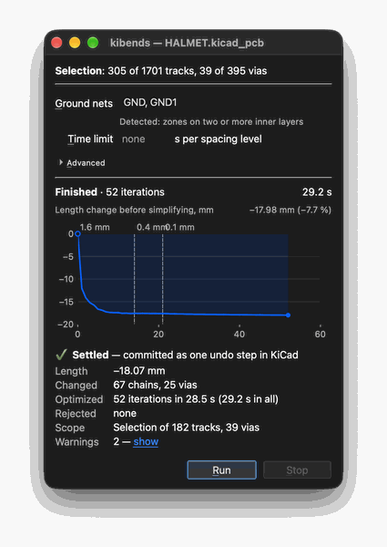

# kibends

kibends smooths the tracks of a KiCad board. It replaces each selected
route with a short, smooth path that keeps its clearance to other copper,
and it does so in the running PCB editor as one undo step.

<table>
  <tr><th>Before</th><th>After</th></tr>
  <tr>
    <td></td>
    <td></td>
  </tr>
</table>

## Why

Mostly for the looks, as inspired by
[mitxela/kicad-round-tracks](https://github.com/mitxela/kicad-round-tracks):
those pre-1990s hand-drawn PCBs look groovy! There may be theoretical
benefits in reducing the power and signal track lengths, and the more
even spacing between tracks may also help signal integrity a little.

The result follows the board's clearances: netclass clearances and the
edge, hole and hole-to-hole clearances from the project. Custom DRC rules
are not read (see [Limits](#limits)).

The board stays fully editable. The result is ordinary straight track
segments, so you can push, drag and reroute it with KiCad's router like
any other track, and run kibends again afterwards.

The board's topology does not change in general: tracks keep their
connections and stay on the same side of the copper around them. In rare
cases a track can jump over a lone via to its other side, where that
gives a shorter path.

## Install

kibends installs from KiCad's Plugin and Content Manager:

1. In the Plugin and Content Manager, open Manage repositories and add
   `https://github.com/mairas/kibends/releases/download/pcm/repository.json`.
2. Pick the kibends repository, install kibends and apply the changes.
3. Open a board in the PCB editor and press the kibends button in the
   toolbar.

kibends runs outside KiCad. The first press of the button offers to
install [uv](https://docs.astral.sh/uv/) and kibends, which needs an
internet connection, and installs nothing until you agree. Later presses
open the panel, or bring it to the front.

You need KiCad 10 or later, with the API server enabled (Preferences >
Plugins > Enable KiCad API).

kibends has prebuilt packages for Windows on x86_64, macOS on Apple
silicon, and Linux with glibc 2.28 or later on x86_64 and aarch64.
Anywhere else the install builds kibends from source, which needs a Rust
toolchain, 1.90 or later. Without `cargo` on the path, the build downloads
one into its own cache; [rustup](https://rustup.rs) installs one to keep.
An older `cargo` on the path, such as a distribution's package, stops the
build.

The panel needs macOS 14 or later, or on Linux glibc 2.34 or later (2.39
on aarch64).

### Without the plugin manager

kibends is on PyPI. It needs Python 3.14; name it, since one of its
dependencies has no packages for 3.15 yet:

```sh
uv tool install --python 3.14 'kibends[gui]'
```

Without the `gui` extra you get only the [command line](#command-line).

## Using it

1. Open the board in KiCad's PCB editor.
2. Press the kibends button in the PCB editor's toolbar, or run
   `kibends-panel`. A small window opens and stays open between runs.
3. Select the tracks to smooth, on any copper layers, with the vias that
   may move with them. Select nothing to smooth the whole board. The top
   line of the panel says what Run will touch.
4. Press Run. The panel shows the progress and a graph of how much shorter
   the tracks get. Stop ends optimizing and commits the best result so
   far.
5. Look at the result in KiCad. The report in the panel says how much
   length the run saved, how many chains and vias it changed, and any
   warnings. One Ctrl+Z in KiCad undoes the whole run.
6. Refill the zones (B) and run KiCad's DRC.



To change a smoothed route, edit it by hand or with the router, select it
again and run again. After a run on a selection, the new tracks and moved
vias are selected, so a second run needs no new selection.

[The panel](https://github.com/mairas/kibends/blob/main/docs/panel.md) describes its fields and report, and
[What gets smoothed](https://github.com/mairas/kibends/blob/main/docs/selection.md) how kibends reads a selection.

## What it changes and what it does not

- A run is one undo step in KiCad. If any part fails, nothing is
  committed.
- Locked tracks, pads, other nets' copper and the tracks of selected
  groups, such as length-tuning patterns, are never modified.
- A via moves only when it is selected, or the run covers the whole
  board, and only where kibends can tell the move is safe;
  [which vias move](https://github.com/mairas/kibends/blob/main/docs/selection.md#vias) has the rules. A moved via
  stays inside the zones of its net that connected it.
- A route keeps its connections: its ends stay on the pads, vias and
  tracks they meet, and it keeps touching every pad and via it touched.
  Tracks of one net that only cross each other may come apart; see
  [crossing tracks](https://github.com/mairas/kibends/blob/main/docs/selection.md#tracks-of-one-net-that-cross).
- kibends never refills zones and never runs the DRC. Refill the zones and
  run KiCad's DRC after every run.

## Limits

- The output is straight track segments. A selected arc is replaced by
  straight tracks; kibends never draws KiCad arcs.
- kibends cannot read custom DRC rules (`.kicad_dru`) or board minimums.
  It keeps the netclass clearances and the edge, hole and hole-to-hole
  clearances from the project file. [Clearances](https://github.com/mairas/kibends/blob/main/docs/clearances.md) lists
  what only KiCad's DRC checks.
- A selection whose copper already violates a clearance is refused, with
  each place listed.
- Skew between the two tracks of a differential pair is not corrected.
  See [Differential pairs](https://github.com/mairas/kibends/blob/main/docs/differential-pairs.md).

## How it works

kibends looks for the shortest path for each route that still keeps away
from the copper around it. Tracks drift toward the middle of the free space
and bend smoothly round what they have to avoid. It refines all selected
routes and vias together, coarse to fine, so neighbouring tracks make room
for each other. Signal vias are also drawn toward their ground return vias
([Return vias](https://github.com/mairas/kibends/blob/main/docs/return-vias.md)).

## Command line

`kibends smooth` does the same as the panel's Run. It needs a
selection; `--all` smooths the whole board:

```sh
kibends smooth --dry-run   # optimize and report, change nothing
kibends smooth             # optimize and commit
kibends smooth --all       # the whole board, whatever is selected
```

Ctrl-C stops a run and commits the best result so far.
[Command line](https://github.com/mairas/kibends/blob/main/docs/cli.md) lists every option.

## Documentation

- [The panel](https://github.com/mairas/kibends/blob/main/docs/panel.md)
- [What gets smoothed](https://github.com/mairas/kibends/blob/main/docs/selection.md)
- [Differential pairs](https://github.com/mairas/kibends/blob/main/docs/differential-pairs.md)
- [Return vias](https://github.com/mairas/kibends/blob/main/docs/return-vias.md)
- [Clearances](https://github.com/mairas/kibends/blob/main/docs/clearances.md)
- [Command line](https://github.com/mairas/kibends/blob/main/docs/cli.md)
- [Development](https://github.com/mairas/kibends/blob/main/docs/development.md)

kibends uses the KiCad IPC API through
[kicad-python](https://pypi.org/project/kicad-python/).
